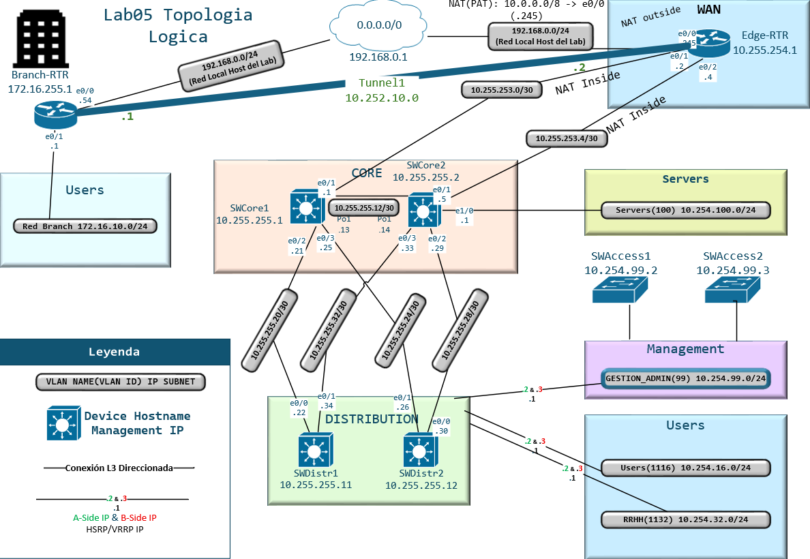
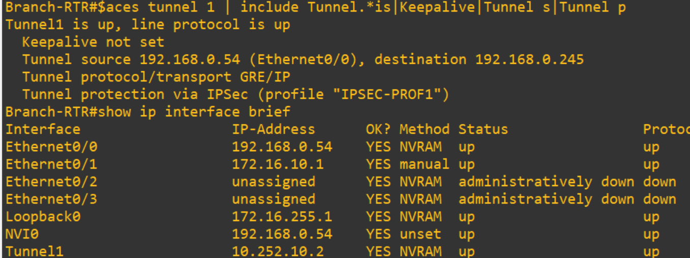
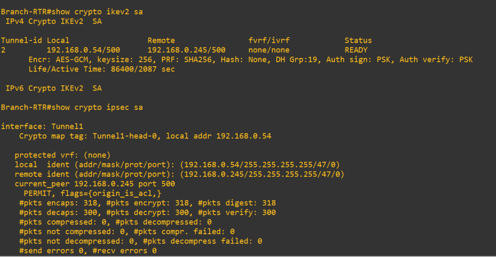
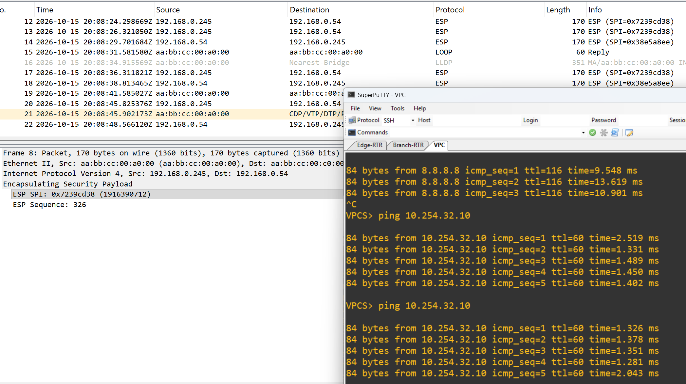
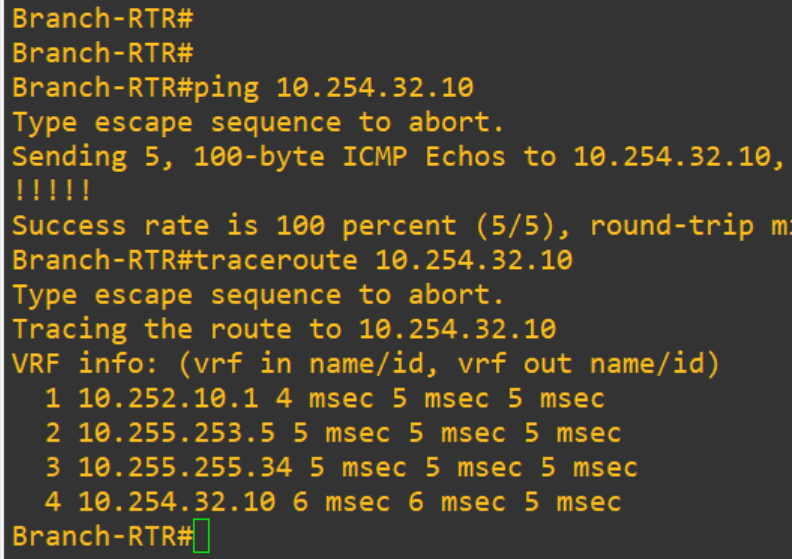
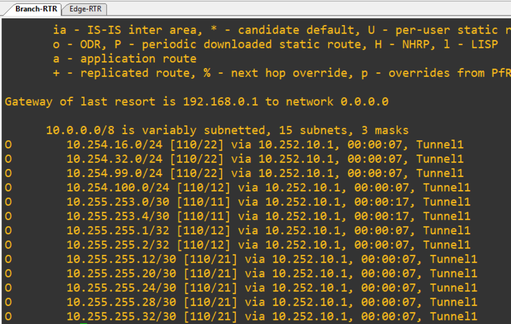

## Lab05-VPN-Site-To-Site-GRE-over-IPsec

# Tecnologías: VPN, ACL, GRE over IPsec, Ikev2, NAT
# Herramientas: Vmware, Eve-NG, Wireshark, Microsoft Visio, Visual Studio Code

 


##  Descripción

En este laboratorio creamos una VPN Site-to-Site con GRE over IPsec desde nuestra red empresarial hacia una sucursal llamada Branch. La comunicación existe entre los routers de borde de cada sitio: Edge-RTR y Branch-RTR, que actualmente solo se comunican por Internet, pero luego de la configuración podrán usar el túnel VPN Site-to-Site.
Implementamos IKEv2, el protocolo estándar de intercambio de claves utilizado hoy en día, y configuramos los routers con los comandos correspondientes. El propósito es crear un túnel lógico entre sucursales para que los datos viajen de forma segura. En esta arquitectura, IKEv2 actúa como el protocolo motor y la estructura unificada que negocia la seguridad, encargándose de dar las instrucciones directas a IPsec. De este modo, IPsec ejecuta las tecnologías criptográficas necesarias para garantizar la confidencialidad, integridad y autenticación de toda la comunicación a través del túnel.

Objetivos:

1. Configurar el túnel lógico GRE (interfaces Tunnel) en Edge-RTR y Branch-RTR para permitir el transporte de tráfico de enrutamiento y multicast, habilitando así el uso de OSPF de manera más eficaz.
2. Crear una propuesta eficiente para la Fase 1 del túnel de control en ambos routers (Edge-RTR y Branch-RTR).
3. Definir la política de la Fase 2 (IPsec Crypto Profile / Transform Set) utilizando IKEv2 para proteger el tráfico encapsulado por GRE.
4. Asociar el perfil de seguridad IPsec directamente a las interfaces del túnel GRE (Tunnel Protection).
5. Implementar un protocolo de enrutamiento dinámico sobre el túnel y verificar la adyacencia, el intercambio de rutas y el cifrado del tráfico.
6. Realizar las comprobaciones correspondientes mediante comandos de diagnóstico (show commands).

Notas de campo

• Considero que lo ideal siempre es utilizar una propuesta actualizada que utilice tecnologías que garanticen la seguridad a día de hoy. Por ello, para la confidencialidad se utilizó AES-GCM de 256 bits, y SHA-256 como mínimo para la integridad y un buen hash.

• GRE encapsula el paquete IP principalmente para que protocolos como OSPF puedan funcionar entre sucursales WAN. Aunque físicamente el tráfico sigue saltando por los routers de Internet, GRE crea una línea directa lógica (virtual) para que OSPF pueda interactuar entre los routers de ambas sucursales y compartir sus tablas de enrutamiento de forma automática.

• IPsec encapsula toda la cabecera (header) de GRE junto con el paquete IP original. De esta forma, conseguimos que los datos viajen completamente seguros por la red pública, sumando el beneficio de usar OSPF entre las sucursales para que las rutas se compartan automáticamente.


---

##  Topología de la Red
Microsoft Visio



###  Subnets

|Subnet|Descripción|
|:----|:----|
|10.255.255.0|Distri y Cores|
|10.254.100.0|Servers|
|10.254.16.0|Vlan Users|
|10.254.32.0|Vlan RRHH|
|10.254.99.0|Vlan Management|
|10.255.254.0|Cores y Edge-RTR|
|10.252.10.0|VPN Tunnel 1|
|172.16.10.0|Branch Subnet|
|192.168.0.0|Red local del Host del Lab|

###  Device's Management IPs

|Dispositivo|Management IP| OSPF Router ID
|:----|:----|:----|
|SWCore1|10.255.255.1| 10.255.255.1 |
|SWCore1|10.255.255.2| 10.255.255.2 |
|SWDistr1|10.255.255.11| 10.255.255.11 |
|SWDistr2|10.255.255.12| 10.255.255.12 |
|SWAccess1|10.254.99.2|
|SWAccess2|10.254.99.3|
|Edge-RTR|10.255.254.1| 10.255.254.1 |
|Branch-RTR|172.16.255.1| 172.16.255.1 |
|Server|10.254.100.100|


###  Tabla de Direccionamiento 


|Dispositivo|Interfaz|Tipo de Puerto|VLAN|Dirección IP / Máscara|Gateway / Next-Hop|Vecino/ Puerto Destino|
|:----|:----|:----|:----|:----|:----|:----|
|SWCore1|Loopback 0|Logico|N/A|10.255.255.1/32|N/A|N/A|
| |Po1|Enrutado|N/A|10.255.255.13/30|10.255.255.14/30|SWCore2 (Po1)|
| |e0/0|Po1|N/A|N/A|N/A|SWCore2 (e0/0)|
| |e0/1|Po1|N/A|N/A|N/A|SWCore2 (e0/1)|
| |e0/2|Enrutado|N/A|10.255.255.21/30|10.255.255.22/30|SWDistr1 (e0/0)|
| |e0/3|Enrutado|N/A|10.255.255.25/30|10.255.255.26/30|SWDistr2 (e0/1)|
|SWCore2|Loopback 0|Logico|N/A|10.255.255.2/32|N/A|N/A|
| |Po1|Enrutado|N/A|10.255.255.14/30|10.255.255.13/30|SWCore1 (Po1)|
| |e0/0|Po1|N/A|N/A|N/A|SWCore1 (e0/0)|
| |e0/1|Po1|N/A|N/A|N/A|SWCore1 (e0/1)|
| |e0/2|Enrutado|N/A|10.255.255.29/30|10.255.255.30/30|SWDistr2 (e0/0)|
| |e0/3|Enrutado|N/A|10.255.255.33/30|10.255.255.34/30|SWDistr1 (e0/1)|
| |Vlan 100|SVI|100|10.254.100.1/24|10.254.100.100|Server (e/0)|
|SWDistr1|Loopback 0|Logico|N/A|10.255.255.11/32|N/A|N/A|
| |e0/0|Enrutado|N/A|10.255.255.22/30|10.255.255.21/30|SWCore1 (e0/2)|
| |e0/1|Enrutado|N/A|10.255.255.34/30|10.255.255.33/30|SWCore2 (e0/3)|
| |e0/2|Trunk|99,1116,1132|N/A|N/A|SWAccess1 (e0/1)|
| |e0/3|Trunk|99,1116,1132|N/A|N/A|SWAccess2 (e0/2)|
| |Vlan 99|SVI|99|10.254.99.2/24|HSRP 10.254.99.1/24|Gestión|
| |Vlan 1116|SVI|1116|10.254.16.2/24|HSRP 10.254.16.1/24|N/A|
| |Vlan 1132|SVI|1132|10.254.32.2/24|HSRP 10.254.32.1/24|N/A|
|SWDistr2|Loopback 0|Logico|N/A|10.255.255.12/32|N/A|N/A|
| |e0/0|Enrutado|N/A|10.255.255.30/30|10.255.255.29/30|SWCore2 (e0/2)|
| |e0/1|Enrutado|N/A|10.255.255.26/30|10.255.255.25/30|SWCore1 (e0/3)|
| |e0/2|Trunk|99,1116,1132|N/A|N/A|SWAccess2 (e0/1)|
| |e0/3|Trunk|99,1116,1132|N/A|N/A|SWAccess1 (e0/2)|
| |Vlan 99|SVI|99|10.254.99.3/24|HSRP 10.254.99.1/24 |Gestión|
| |Vlan 1116|SVI|1116|10.254.16.3/24|HSRP 10.254.16.1/24|N/A|
| |Vlan 1132|SVI|1132|10.254.32.3/24|HSRP 10.254.32.1/24 |N/A|
|SWAccess1|e0/0|Access|1116|N/A|N/A|PC1 Linux|
| |e0/1|Trunk|99,1116,1132|N/A|N/A|SWDistr1 (e0/2)|
| |e0/2|Trunk|99,1116,1132|N/A|N/A|SWDistr2 (e0/3)|
|SWAccess2|G0/0|Access|1132|N/A|N/A|PC2 VPC|
| |e0/1|Trunk|99,1116,1132|N/A|N/A|SWDistr2 (e0/2)|
| |e0/2|Trunk|99,1116,1132|N/A|N/A|SWDistr1(e0/3)|
| Edge-RTR    | e0/0     | Enrutado       | N/A  | 192.168.0.254          | 0.0.0.0            | Internet               |   |   |   |
|             | e0/1     | Enrutado       | N/A  | 10.254.253.2           | 10.254.253.1       | SWCore1 (e0/1)         |   |   |   |
|             | e0/2     | Enrutado       | N/A  | 10.254.253.6           | 10.254.253.5       | SWCore2(e0/1)          |   |   |   |
|             | Tunnel1     | Enrutado       | N/A  | 10.252.10.1           | 10.252.10.2      | Edge-RTR(Tunnel1)     |   |   |   |
| Branch-RTR    | e0/0     | Enrutado       | N/A  | 192.168.0.54         | 0.0.0.0          |Internet               |   |   |   |
|             | e0/1     | Enrutado       | N/A  | 172.16.10.1          | Red Branch       | VPC (eth0)         |   |   |   |
|             | Tunnel1     | Enrutado       | N/A  | 10.252.10.2           | 10.252.10.1     | Branch-RTR(Tunnel1)     |   |   |   |


###  Configuración de dispositivos

Las configuraciones completas de cada dispositivo están disponibles en la carpeta [`configuraciones/`](./configuraciones):

|Dispositivo|Archivo|Descripción|
|:----|:----|:----|
|SWAccess1|[Config-SWAccess1.ios](./Configuraciones/Config-SWAccess1.ios)|Config Completa|
|SWAccess2|[Config-SWAccess2.ios](./Configuraciones/Config-SWAccess2.ios)|Config Completa|
|SWDistr1|[Config-SWDistr1.ios](./Configuraciones/Config-SWDistr1.ios)|Config Completa|
|SWDistr2|[Config-SWDistr2.ios](./Configuraciones/Config-SWDistr2.ios)|Config Completa|
|SWCore1|[Config-SWCore1.ios](./Configuraciones/Config-SWCore1.ios)|Config Completa|
|SWCore2|[Config-SWCore2.ios](./Configuraciones/Config-SWCore2.ios)|Config Completa|
|Edge-RTR|[Config-Edge-RTR.ios](./Configuraciones/Config-Edge-RTR.ios)|Config Completa|
|Branch-RTR|[Config-Branch-RTR.ios](./Configuraciones/Config-Branch-RTR.ios)|Config Completa|

###  Pruebas y Verificación

### Verificación de Configuraciones (Ejecucion de comandos, show commands y capturas)

1.  Creamos el tunel logico en ambos routers con el comando interface tunnel, ademas bajamos el MTU de 1500 a 1400 por el peso que llevaran las cabeceras IPsec y GRE, asi evitamos que no se fragmenten los paquetes, tambien cambiamos el MSS para que obviamente los clientes finales manden paquetes del tamaño adecuado.

Edge-RTR
```
! --- VPN SITE TO SITE --- !
interface tunnel 1
tunnel source e0/0
tunnel destination 192.168.0.54
ip address 10.252.10.1 255.255.255.0
tunnel protection ipsec profile IPSEC-PROF1
ip mtu 1400
ip tcp adjust-mss 1360
exit
!
```
Branch-RTR
```
! --- VPN SITE TO SITE --- !
interface tunnel 1
tunnel source e0/0
tunnel destination 192.168.0.245
ip address 10.252.10.2 255.255.255.0
tunnel protection ipsec profile IPSEC-PROF1
ip mtu 1400
ip tcp adjust-mss 1360
exit
!
```
2. Crear una propuesta eficiente para la Fase 1 para el túnel de control de ambos router (Edge-RTR y Branch-RTR)
- Elegimos aes-gcm-256 para la confidencialidad del tunel de control.
- Elegimos Sha256 para la integridad
- Group 19 de Diffie-hellman para las llaves con la que cifraran.
- Adjuntamos a la policy para que un receptor que el router receptor pueda validar y coincidir en la negociación.
- Creamos el llavero (Indica que si esa ip se comunica pues debe tener esa PSK)


Branch-RTR
```
! --- Cryptografia --- !
crypto ikev2 proposal PROP1
encryption aes-gcm-256
prf sha256
group 19
exit
!
crypto ikev2 policy POL1
proposal PROP1
exit
!
crypto ikev2 keyring KR1
peer Edge-RTR
address 192.168.0.245
pre-shared-key vpn123
end
!
```

Edge-RTR
```
! --- Cryptografia --- !
crypto ikev2 proposal PROP1
encryption aes-gcm-256
prf sha256
group 19
exit
!
crypto ikev2 policy POL1
proposal PROP1
exit
!
crypto ikev2 keyring KR1
peer Branch-RTR
address 192.168.0.54
pre-shared-key vpn123
end
```
3. Definir la política de la Fase 2 (IPsec Crypto Profile/Transform Set) utilizando IKEv2 para proteger el tráfico encapsulado por GRE.
4. Asociar el perfil de seguridad IPsec directamente a las interfaces del túnel GRE (Tunnel Protection). (ya esta agregado en el paso 1: tunnel protection ipsec profile IPSEC-PROF1)

- Match identity indica que cuando la conexión venga de esa IP se active este perfil que busca la PSK en el llavero.
- Aqui en el transform-set especificamos el cifrado esp-gcm 256 que cifra los datos reales que viajaran.
- el modo de IPSec es "transport" ya que GRE ya agrego una cabecera y IPsec protege todo lo demás.

Edge-RTR
```
crypto ikev2 profile PROF1
match identity remote address 192.168.0.54 255.255.255.255
authentication remote pre-share
authentication local pre-share
keyring local KR1
end
conf t
!
crypto ipsec transform-set Tunelgre esp-gcm 256
mode transport
exit
crypto ipsec profile IPSEC-PROF1
set transform-set Tunelgre
set pfs group19
set ikev2-profile PROF1
end
!
```

Branch-RTR
```
crypto ikev2 profile PROF1
match identity remote address 192.168.0.245 255.255.255.255
authentication remote pre-share
authentication local pre-share
keyring local KR1
end
conf t
!
crypto ipsec transform-set Tunelgre esp-gcm 256
mode transport
exit
crypto ipsec profile IPSEC-PROF1 
set transform-set Tunelgre
set pfs group19
set ikev2-profile PROF1
end
!
```
5.  Implementar un protocolo de enrutamiento dinámico sobre el túnel y verificar la adyacencia, el intercambio de rutas y el cifrado del tráfico.

Edge-RTR
```
router ospf 1
network 10.252.10.1 0.0.0.0 area 0
exit
```
Branch-RTR
```
router ospf 1
network 10.252.10.2 0.0.0.0 area 0
exit
```
## 6. Comprobaciones y show commands

**TUNELES UP**

Una vez configurados los routers podemos ejecutar:
- Show ip interface
- show interfaces tunnel 1 | include Tunnel.*is|Keepalive|Tunnel s|Tunnel p




**1º FASE (tunel de control) OK y 2º FASE (Ipsec) OK**

- El Status: Ready indica que se negoció con exito el control
- El protoclo 47 GRE, el "permit" y el contador de paquetes encapsulados, encriptados y enviados, ademas de los desencapsulados desencriptados y verificados indica que la Fase 2 tambien esta OK y el tunel esta funcionando correctamente. 



**Wireshark demostrando el trafico encapsulado en ESP**
- Capturamos la interfaz e0/0 de Edge-RTR cuando hacemos Ping desde VPC (Red Branch) hacia PC2
- Y observamos el trafico es un payload seguro gracias a ESP (Solamente se puede ver una comunicacion entre ambos routers, pero nada mas)





**Traceroute desde la red Branch hasta la PC2 (Red RHHH)**
- Efectivamente el primer salto es 10.252.10.1 (Extremo del tunel de Edge-RTR)





**Rutas OSPF aprendidas a travez del tunel por Branch-RTR**
- Y asi la sucursal Branch ha aprendido las rutas OSPF de las subnets de la sucursal principal gracias a GRE que permite protocolos multicast.



##  Skills Learned

• Diseño de VPNs Corporativas: Configuración e implementación de arquitecturas seguras Site-to-Site

• Protocolos de Cifrado y Seguridad

• Virtualización de Redes con GRE

• Criptografía Avanzada

• Troubleshooting de tecnología VPN

